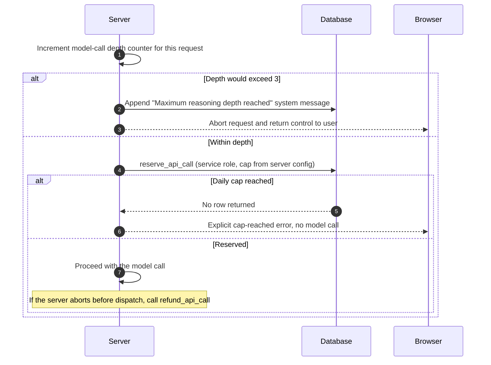
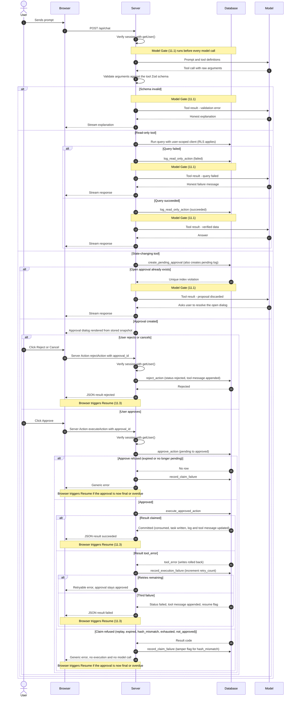
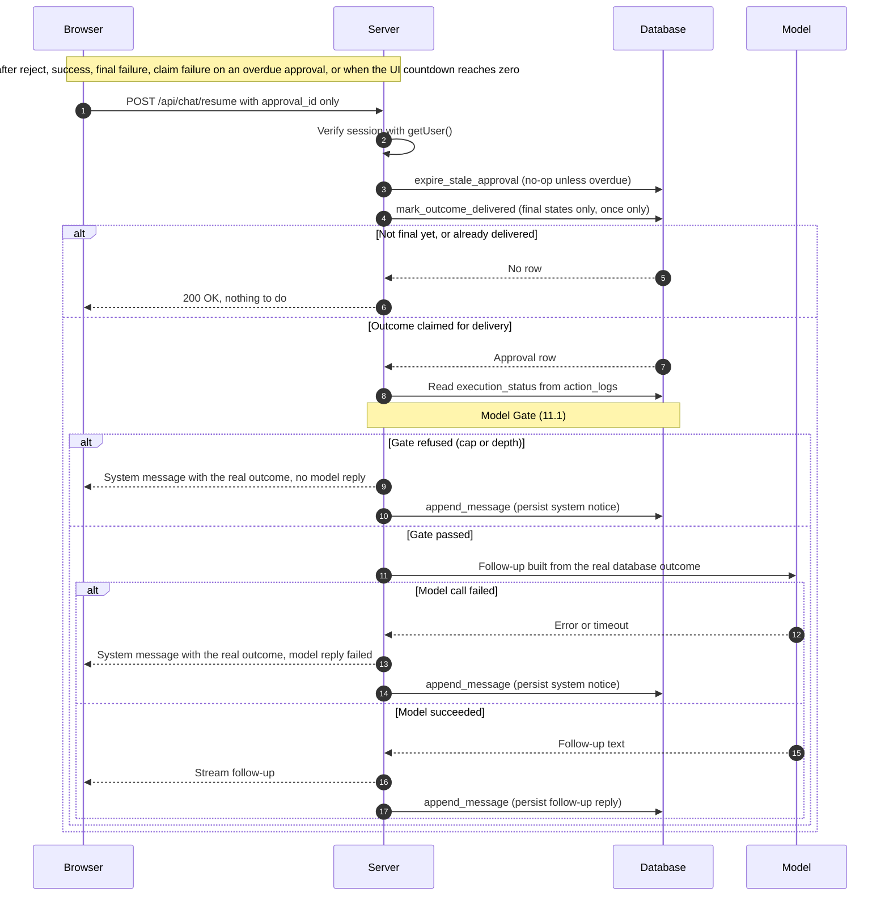

# ARCHITECTURE.md

**Project:** FLASH (private, single-user personal AI assistant)
**Status:** Final candidate for approval. This file supersedes every earlier patch and draft of the architecture.
**Labels used:** [DECIDED] settled. [PROPOSED] recommended, change only with a stated reason. [OPEN] unverified, must be checked before relying on it.

---

## 1. Principles

1. **Zero-trust AI.** Model output is untrusted input. The model can request actions, never perform or approve them.
2. **Server authority.** The browser is untrusted. Every permission decision is made on the server and, for security tables, in the database.
3. **Honest reporting.** FLASH never claims an action succeeded unless the database confirms it. The model may only describe outcomes that the server reads back from the database.
4. **Simplicity.** No Redis, no vector database, no microservices, no agent framework.
5. **Fail closed.** If a check cannot be completed (rate limit, ownership, approval), the action does not happen.

---

## 2. System Layers

1. **Frontend (client, untrusted):** Next.js client components for the dashboard, chat, tasks and notes, memories, documents, activity log, and approval dialogs. The approval dialog renders the stored parameter snapshot from the database, never model-written text.
2. **Server application (trusted):** Next.js Server Actions and Route Handlers.
   - Chat streaming and conversation resume use **Route Handlers** (`app/api/chat/route.ts` and `app/api/chat/resume/route.ts`) [PROPOSED].
   - User mutations (approve, reject, execute, task and note edits) use **Server Actions**, which return JSON results and never stream.
   - Every Server Action and Route Handler verifies the session itself with `getUser()`. The proxy or middleware is never the only check.
3. **AI provider adapter:** An isolated layer wrapping the Vercel AI SDK [PROPOSED]. Handles model requests, streaming, and tool-call parsing. Provider-specific code stays here.
4. **Tool registry:** A server-side explicit allowlist. Each tool defines name, description, Zod input schema, read-only versus state-changing, permissions, and its execution path.
5. **Database:** Supabase PostgreSQL. Row Level Security (RLS) enforces ownership. Postgres functions enforce approval rules.
6. **External adapters (later milestones):** Speech (M4), document processing (M5), web search (M6). All external data is hostile input.
7. **Future (out of v1):** A local companion app with narrow permissions.

---

## 3. Threat Model and Trust Boundaries

**What the approval system protects against:** the model hallucinating an action, and prompt injection (hostile text in a document or web page) steering the model into acting without your consent.

**What it does NOT protect against:** a compromised browser (for example cross-site scripting) or a stolen session token. An attacker holding your live session can click "Approve" themselves.

**Mitigations and residual risk:**
- Strict nonce-based Content Security Policy (Section 8).
- Single-user system: public signups disabled.
- Hard daily model-call cap, which limits what a stolen session can do.
- Supabase JWT lifetime: default 3600 seconds (1 hour). Recorded M1-0 (2026-11-07, owner screenshot): after the move to JWT signing keys the dashboard no longer shows an expiry field, so the project uses Supabase's default of 3600 seconds. Not verified as configurable on the free plan; the short default is acceptable. (See TECH_STACK.md §3.2.)
- Residual risk: within the daily cap, a stolen session can approve actions.

**RLS limits:** RLS filters database rows by owner. It does not stop application bugs, prompt injection, or a leaked service-role key. Authentication is checked in application code as well.

---

## 4. Data Access Identity and Function Access Matrix

### 4.1 Identity rules
- All ordinary user-data reads and writes (conversations, messages, tasks, notes, memories, settings, read-only tool queries) use a **user-scoped Supabase client** carrying the user's JWT, so RLS applies.
- The **service-role key** bypasses RLS. It exists only in server environment variables, never reaches the browser, and is used **only** to call the service-role functions listed below. No other service-role use is permitted without updating this document.

### 4.2 Why a function matrix is needed (plain language)
The browser holds the same JWT that the server uses with Supabase. A malicious script could skip Next.js and call database functions directly with that token. So every database function must be safe even if called directly by the user, and any function that must be server-only is made callable only by the service role.

### 4.3 Rules for every function
- `REVOKE EXECUTE ... FROM PUBLIC, anon;` then `GRANT EXECUTE` only to the roles in the matrix.
- `SECURITY DEFINER` only where justified (writing to security tables the client cannot write). Always `SET search_path = public, pg_temp`.
- Functions callable by `authenticated` learn the user from `auth.uid()` and take no user ID parameter.
- Functions callable only by `service_role` receive `p_user_id`, which the server obtained from `getUser()`. A client can never reach them.
- Security values (daily cap, approval TTL) are passed only to service-role-only functions from server configuration. A client-callable function never accepts them.

### 4.4 Matrix

| Function | Caller | Inputs | User identity from | Purpose |
|---|---|---|---|---|
| `reserve_api_call` | service_role | `p_user_id`, `p_cap` | parameter | Atomic upsert reserving one model call for today. Returns no row when the cap is reached. |
| `refund_api_call` | service_role | `p_user_id`, `p_usage_date` | parameter | Refunds a reservation when the server aborted before contacting the model provider. |
| `create_pending_approval` | service_role | `p_user_id`, `p_conversation_id`, `p_tool_call_id`, `p_tool`, `p_params`, `p_ttl_seconds` | parameter | In one transaction: expire stale open approvals for the conversation, insert the approval snapshot (Postgres computes `parameters_hash` and `expires_at`), and insert the `pending` action log. Fails if another open approval exists. |
| `log_read_only_action` | service_role | `p_user_id`, `p_conversation_id`, `p_tool`, `p_params`, `p_status`, `p_result` | parameter | Audit row for a read-only tool call (no approval). |
| `record_execution_failure` | service_role | `p_approval_id`, `p_user_id`, `p_error` | parameter | Separate call after a rolled-back execution. Increments `retry_count`, appends the error to the log. At 3 failures it sets status `failed`, marks the log `failed`, appends the tool message, and returns a flag so the server resumes immediately. |
| `record_claim_failure` | service_role | `p_approval_id`, `p_user_id`, `p_reason`, `p_is_tamper` | parameter | Audit row when a claim is refused (replay, expired, hash mismatch, exhausted). For `hash_mismatch` (tamper) it is also terminal: the approval becomes `failed`, the original pending log becomes `not_executed` with the tamper flag, a tool message is appended, and a resume flag is returned. |
| `expire_stale_approval` | service_role | `p_user_id`, `p_approval_id` | parameter | Atomically marks an overdue `pending` or `approved` approval `expired`, marks its log `not_executed`, appends the tool message. |
| `mark_outcome_delivered` | service_role | `p_user_id`, `p_approval_id` | parameter | Atomically sets `outcome_delivered_at` once, only for final states. |
| `append_message` | service_role | `p_user_id`, `p_conversation_id`, `p_role` (assistant or system only), `p_content`, `p_parts`, `p_tool_call_id` | parameter | Persists assistant and system messages (streamed replies, depth-abort notices, cap notices). Exists so the browser can never forge them. |
| `approve_action` | authenticated | `p_approval_id` | `auth.uid()` | Atomic `pending` to `approved`, only if unexpired. |
| `reject_action` | authenticated | `p_approval_id` | `auth.uid()` | Atomic `pending` or `approved` to `rejected` (the Cancel path), appends the tool message, marks the log `not_executed`. |
| `execute_approved_action` | authenticated | `p_approval_id` | `auth.uid()` | Claim, run the tool via a fixed allowlist, update the log, append the tool message, all in one transaction. Returns a result code. |

[PROPOSED] `log_tool_proposal` from earlier drafts is merged into `create_pending_approval` so an approval can never exist without its log row.

### 4.5 Service-role allowlist
Exactly the nine service-role functions in the matrix, plus `save_document_extraction` from M5 [DECIDED, M5-0 2026-11-07, owner approved: page text must be written only by the server's extraction step, so citations point at text no client could forge], and `reserve_search` / `refund_search` from M6 [DECIDED, M6-1: the daily web-search cap, same design as the model cap]. Nothing else uses the service-role key.

---

## 5. Approval Lifecycle

### 5.1 States

| Status | Set by | Final? |
|---|---|---|
| `pending` | `create_pending_approval` | no |
| `approved` | `approve_action` | no |
| `consumed` (executed successfully) | `execute_approved_action` | yes |
| `rejected` | `reject_action` | yes |
| `expired` | `expire_stale_approval` | yes |
| `failed` | `record_execution_failure` (third failure) or `record_claim_failure` (hash mismatch) | yes |

Expiry is a computed condition (`now() > expires_at`) with lazy marking. No cron job.

### 5.2 Binding
Every approval is bound to the tool name, user ID, conversation ID, tool call ID, and the exact validated parameters. Parameters are immutable after creation. `expires_at` is computed by Postgres from a server-supplied TTL [PROPOSED: 5 minutes, configurable so tests can use seconds].

### 5.3 Hashing
Postgres computes `parameters_hash` itself, as the SHA-256 of the stored JSONB text, both at creation and again at execution. Computing it on both sides in Postgres avoids mismatches between JavaScript and Postgres JSON serialization.

### 5.4 Atomic transitions
Every transition is one conditional `UPDATE ... RETURNING`. A separate `SELECT` then `UPDATE` is unsafe because two parallel requests can both read the same valid state and both proceed. A single conditional update lets exactly one request win.

```sql
-- approve_action
UPDATE tool_approvals SET status = 'approved', approved_at = now()
WHERE id = p_approval_id AND user_id = auth.uid()
  AND status = 'pending' AND expires_at > now()
RETURNING *;

-- reject_action (Cancel)
UPDATE tool_approvals SET status = 'rejected'
WHERE id = p_approval_id AND user_id = auth.uid()
  AND status IN ('pending','approved') AND expires_at > now()
RETURNING *;

-- claim inside execute_approved_action
UPDATE tool_approvals SET status = 'consumed', consumed_at = now()
WHERE id = p_approval_id AND user_id = auth.uid()
  AND status = 'approved' AND expires_at > now() AND retry_count < 3
  AND parameters_hash = encode(sha256(convert_to(parameters::text,'UTF8')),'hex')
RETURNING *;

-- expire_stale_approval
UPDATE tool_approvals SET status = 'expired'
WHERE id = p_approval_id AND user_id = p_user_id
  AND status IN ('pending','approved') AND expires_at <= now()
RETURNING *;
```

### 5.5 Result codes from `execute_approved_action`
`claimed` (success), `tool_error`, `replay`, `expired`, `hash_mismatch`, `exhausted`, `not_approved`.
- If the claim returns no row, the function classifies the reason by reading the row and returns the matching code. This read is only for classification, never for authorization.
- The tool write runs inside the same function in an `EXCEPTION` block. If the tool write fails, its changes (including the claim) are rolled back and the function returns `tool_error`.
- The server calls `record_claim_failure` only for `replay`, `expired`, `hash_mismatch`, `exhausted`, `not_approved`. `hash_mismatch` is flagged as a possible tamper event and is terminal: the approval is marked `failed` so it can never run.

### 5.6 Dispatch allowlist
`execute_approved_action` uses a hardcoded branch per tool (for example `IF tool = 'create_task' THEN ... ELSIF tool = 'save_memory' THEN ... ELSE RAISE EXCEPTION 'Unknown tool'`). It never builds SQL from stored parameter text. Database CHECK constraints are the second validation layer behind Zod.

### 5.7 Retry rules
- A failed tool write leaves the approval `approved`, so the user may retry until expiry.
- `retry_count` is incremented only by `record_execution_failure`, in a separate server call, because anything incremented inside the rolled-back transaction would vanish.
- On the third failure, `record_execution_failure` sets status `failed` immediately and returns a flag so the server triggers Resume at once. The `retry_count < 3` condition in the claim is defense in depth.

### 5.8 One open approval per conversation
A partial unique index enforces it in the database:
`CREATE UNIQUE INDEX ... ON tool_approvals (conversation_id) WHERE status IN ('pending','approved');`
If the model proposes a second state-changing action while one is open, the proposal is discarded and the model receives an error result. This limits approval flooding from injected content. The user can dismiss a forgotten dialog with Cancel (`reject_action`), or it expires on its own.

### 5.9 Tool message at every final state
The real outcome is written to `messages` (role `tool`) by the same function that sets the final state, inside that function's transaction:
`execute_approved_action` (success), `reject_action` (rejected), `expire_stale_approval` (expired), `record_execution_failure` (failed), `record_claim_failure` (hash mismatch). If the browser closes before Resume, the outcome is already in conversation history.

### 5.10 Unseen expiry
When the approval countdown in the UI reaches zero, the browser triggers Resume.

---

## 6. Model Gate: Rate Limit, Depth, Refunds

**Rule:** every model call, including follow-ups after tool results and Resume follow-ups, passes the Model Gate first.

1. **Depth check.** Maximum **3 model calls per request** (a chat request or a resume request) [PROPOSED]. A fourth attempt aborts the request, appends a "Maximum reasoning depth reached" system message, and returns control to the user. The counter resets on each new user message or resume request.
2. **Reservation.** `reserve_api_call` runs before dispatch. If it returns no row the server returns an explicit cap-reached error and makes no model call. The gate fails closed.

```sql
INSERT INTO api_usage (user_id, usage_date, model_calls)
VALUES (p_user_id, (now() AT TIME ZONE 'Asia/Kolkata')::date, 1)
ON CONFLICT (user_id, usage_date)
DO UPDATE SET model_calls = api_usage.model_calls + 1
WHERE api_usage.model_calls < p_cap
RETURNING model_calls;
```

3. **Cap:** [DECIDED] 20 model calls per day (M1-0, 2026-11-07), matching the Gemini free tier's 20 requests per day. The cap counts model calls, not chat messages. Env override `DAILY_MODEL_CALL_CAP`.
4. **Day boundary:** [PROPOSED] `Asia/Kolkata` midnight, so resets match local time. UTC is the alternative.
5. **Refunds:** only if the server deliberately aborts before dispatching to the provider. Never refund timeouts, dropped connections, or provider 5xx errors, because the provider may already have used quota. Clamp at zero, applied to the original reservation date. A crashed server cannot issue refunds, so a crash simply costs one call.

---

## 7. Outcome Delivery and Resume

The browser calls `POST /api/chat/resume` with **only** `approval_id` after: reject, execution success, final failure, a claim failure caused by expiry, or the UI countdown reaching zero. The browser never sends outcome text.

Server steps:
1. Verify the session with `getUser()` and ownership.
2. Call `expire_stale_approval` (a no-op unless the approval is overdue).
3. Call `mark_outcome_delivered`. It succeeds only for final states and only once. If it returns no row (not final yet, for example between retries, or already delivered), respond 200 and do nothing.
4. Read the real outcome from `action_logs.execution_status` and the approval status. Possible outcomes: succeeded, failed, not_executed (rejected or expired), unknown.
5. Pass the Model Gate (Section 6).
6. Build the follow-up system message from the database outcome and call the model. The model is told to report only that outcome.
7. The streamed follow-up reply is persisted with `append_message` (assistant role). If the Gate refuses (cap or depth) or the model call fails, the UI shows the real outcome with an honest message generated from the actual state, for example "Action succeeded. Daily limit reached, no model reply is available." That notice is also persisted with `append_message` (system role), so a page refresh shows the same history. Nothing is hidden or assumed. The tool message is already in history, so the next turn has the context.

**`unknown` status:** reserved for future external-network tools where a timeout leaves the outcome ambiguous. V1 tools only touch Postgres inside transactions, so their results are only `succeeded`, `failed`, or `not_executed`. When `unknown` does occur, the user is told the action was attempted, the outcome is unverified, and they should check before retrying.

---

## 8. Output Rendering and Content Security Policy

- **Markdown:** raw HTML disabled; remote images and embeds (`img`, `iframe`, `object`, `embed`) never rendered; links open with `rel="noopener noreferrer"` and show their destination domain.
- **CSP:** strict nonce-based policy. A nonce is generated per request in the request-interception file and applied to Next.js scripts.
  - **File name:** Next.js 16 renamed `middleware.ts` to `proxy.ts`. Use the name matching the pinned version: `proxy.ts` (Next.js 16.4.1, verified in the official docs 2026-10-16; see TECH_STACK.md Section 2).
  - **Matcher:** skip static assets and API routes where appropriate.
  - **`unsafe-eval`:** development only.
  - **Rollout:** start with `Content-Security-Policy-Report-Only`, then enforce.
  - **`connect-src`:** `'self'` and the Supabase project URL, plus later any speech or search endpoints that are called from the browser.
  - **Cost:** nonces force dynamic rendering and disable static optimisation. Acceptable for a private app.
  - **Boundary:** the proxy is not an authorization layer; checks live in Server Actions and Route Handlers.
- **Honest limit:** CSP and image blocking reduce automated data exfiltration (for example tracking pixels). They do not eliminate it: a prompt injection can still persuade you to click a malicious link.

---

## 9. Untrusted Content Handling

- Document text, web results, and other external content are placed in prompts inside clearly delimited data blocks (for example `=== UNTRUSTED DATA START === ... === UNTRUSTED DATA END ===`). This is defense in depth, not a guarantee against jailbreaks.
- Approved memories are injected as delimited user data, not as instructions.
- No injected text can grant permissions: tool calls always go through schema validation, the approval flow, and database-level checks.
- Secrets and tokens are never placed in prompts.

---

## 10. Error Handling and Logging

- Clients receive generic messages ("Action failed", "Approval expired") plus a short error code. No stack traces, SQL errors, or secrets reach the browser.
- Servers log full details internally with secrets and personal data redacted. Never log API keys, tokens, or full document text.
- Every action in `action_logs` records: proposed action, tool, validated parameters, approval status, execution status, timestamp, and result or error.
- `action_logs` rows are never deleted by deleting a task or conversation.

---

## 11. Diagrams

Render check: paste each block into mermaid.live.

### 11.1 Model Gate (runs before every model call)



### 11.2 Main flow



### 11.3 Resume



---

## 12. Schema Implications (for DATABASE.md)

- `tool_approvals`: `id`, `user_id`, `conversation_id`, `tool_call_id`, `tool_name`, `parameters` (JSONB, immutable), `parameters_hash`, `status` with CHECK in (`pending`,`approved`,`consumed`,`rejected`,`expired`,`failed`), `retry_count` (default 0, CHECK 0 to 3), `expires_at`, `approved_at`, `consumed_at`, `outcome_delivered_at`, `created_at`. Partial unique index on `conversation_id` where status in (`pending`,`approved`).
- `action_logs`: `execution_status` CHECK in (`pending`,`succeeded`,`failed`,`unknown`,`not_executed`); claim failures are stored as `not_executed` rows with a reason and a tamper flag in `result_payload`.
- `messages`: role CHECK includes `tool`; `tool_call_id` links messages to approvals and logs; a JSONB column stores tool-call parts. **Message forgery rule:** the model reads conversation history, so history must be trustworthy. Client roles may INSERT only rows with `role = 'user'` and may not UPDATE message content. Assistant, system, and tool messages are written only by `append_message` or by the approval functions in Section 4 (SECURITY DEFINER).
- `api_usage`: composite key (`user_id`, `usage_date`), column `model_calls`.
- `settings`: `memory_enabled`.
- Composite foreign keys so related rows share an owner (for example messages to conversations on `(conversation_id, user_id)`).
- Client roles may only `SELECT` `tool_approvals`, `action_logs`, `api_usage`. All writes go through the functions in Section 4. Table privileges are also revoked explicitly (`REVOKE ALL ... FROM anon, authenticated`, then `GRANT SELECT` to `authenticated`), because Supabase grants broad default privileges on new public tables and RLS alone should not be the only barrier.
- **Conversation deletion:** deleting a conversation must not delete `tool_approvals` or `action_logs`, and must not leave an executable orphan. Audit tables keep their rows with `conversation_id` set to NULL on conversation delete (`ON DELETE SET NULL (conversation_id)`, Postgres 15 or later; verify the Supabase Postgres version). A conversation with an open (`pending` or `approved`) approval cannot be deleted until the user cancels it.
- **Documents (M5) [DECIDED, M5-0 2026-11-07, owner approved]:** `documents` (owner rows; client may insert only a `processing` row and delete; no client update), `document_pages` (client SELECT only; written by the service-role `save_document_extraction`; composite FK to `documents (id, user_id)` with cascade; GIN full-text column like `notes`), and a private Storage bucket `documents` with owner-folder policies (no UPDATE, so files cannot be swapped after extraction). Upload flow: route checks `getUser()`, size (4 MB, under Vercel's 4.5 MB body limit) and the `%PDF-` magic bytes, uploads to `<user_id>/<document_id>.pdf` with the user-scoped client, inserts the row, extracts page by page with `unpdf`, then calls `save_document_extraction`. Page text is untrusted data (Section 9). Full details: DATABASE.md 3.10 to 3.12.

---

## 13. Open Items

- [x] Supabase JWT expiry: default 3600 seconds; not shown in the dashboard after the signing-key migration (M1-0, TECH_STACK.md 3.2).
- [x] Pinned Next.js version and the matching request-interception file name: Next.js 16.4.1, `proxy.ts` (M0-0, 2026-10-16).
- [x] Gemini model `gemini-3.8-flash`, free tier RPM 5, TPM about 250,000, RPD 20 (requests per day) (M1-0, TECH_STACK.md 3.3).
- [x] Privacy (M3-0, owner 2026-11-07): free Gemini tier, non-sensitive memories only, warning on the Memory screen (PRD.md Section 9, TECH_STACK.md 3.3).
- [DECIDED] 20 model calls per day cap (M1-0). [PROPOSED] 5-minute approval TTL, depth limit 3, retry limit 3, `Asia/Kolkata` day boundary.
- [PROPOSED] Separate `POST /api/chat/resume` route; merging `log_tool_proposal` into `create_pending_approval`.

